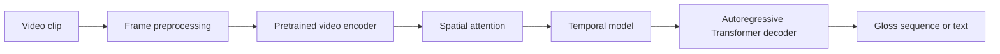

# Sign Language Video Modeling

[](https://github.com/israr-karim/Real-Time-Sign-Language-Recognition-System/actions/workflows/validate.yml)

Undergraduate experiments in continuous sign-language recognition and translation using pretrained video encoders, spatial attention, temporal modelling, and an autoregressive text decoder.

This repository contains reorganized thesis code by **Kazi Israrul Karim**, with readable notebooks, reusable model modules, and a record of the experiments' limitations. The historical GitHub repository name is retained; real-time performance has not been established.

## Start here

| File | Purpose |
| --- | --- |
| [Project overview](notebooks/00_project_overview.ipynb) | A lightweight walkthrough that needs no dataset, model downloads, or GPU |
| [ViViT translation](notebooks/01_vivit_translation.ipynb) | Video-to-text experiment and historical evaluation code |
| [ViViT gloss recognition](notebooks/02_vivit_gloss_recognition.ipynb) | Video-to-gloss training, sequence metrics, and embedding similarity |
| [VideoMAE experiment](notebooks/03_videomae_experiment.ipynb) | Alternative video-encoder experiment; training remains incomplete |
| [Model modules](src/sign_language_lab/) | Attention, losses, experiment-specific encoders and decoders, and path configuration |

The experiments combine a frozen pretrained video encoder with learned spatial attention, a temporal model, and a Transformer decoder. The decoder uses German BERT word embeddings; the provided code does not use BERT's full contextual encoder as its text decoder. The ViViT notebooks explore different configurations and target types, so their model variants remain separate.



## Dataset and references

The experiments use a locally prepared version of **RWTH-PHOENIX-Weather 2014T**. Obtain the upstream data from the [official RWTH Aachen dataset page](https://www-i6.informatik.rwth-aachen.de/~koller/RWTH-PHOENIX-2014-T/), which also specifies the dataset citation. The [dataset guide](docs/dataset.md) distinguishes the upstream release from the converted MP4 files and customized Excel annotations expected by this code.

Dataset and model references are recorded in [the bibliography](docs/references.bib). Checkpoint sources and their reported license terms are listed in [third-party resources](THIRD_PARTY.md). The [software citation](CITATION.cff) describes this repository and does not imply a peer-reviewed publication.

## Current status

The code has been reformatted and reorganized. Dataset and checkpoint paths are configurable, outputs are cleared, and the original notebook names are mapped in the [source manifest](docs/source_manifest.json).

**The historical model results have not been reproduced.** Known problems include frame sampling, ViViT token layout, evaluation split handling, and failed VideoMAE training batches. They are documented in the [experiment review](docs/experiment_review.md). Formatting and module extraction do not resolve those experimental problems. Cosine similarity is an embedding measure and must not be reported as translation accuracy.

## Local setup

Use Python 3.11 or newer for the repository tooling:

```bash
python3 -m venv .venv
source .venv/bin/activate
python -m pip install -r requirements-dev.txt
python scripts/validate_repository.py
```

The research notebooks additionally need the packages listed in `requirements-research.in`, local PHOENIX-2014T data, and the relevant model checkpoints. That file is a dependency inventory rather than a verified training environment. See the [reproduction guide](docs/reproduction.md) before running an experiment.

## Documentation

- [Architecture and implementation](docs/architecture.md)
- [Experiment review and recorded results](docs/experiment_review.md)
- [Setup and reproduction limitations](docs/reproduction.md)
- [Changes made during organization](docs/organization_log.md)
- [Prioritized improvement plan](docs/roadmap.md)
- [Dataset and local preparation](docs/dataset.md)
- [Repository-practice review](docs/repository_review.md)
- [Adding project papers and references](docs/papers.md)

The thesis was a group project. The implementation contribution represented by these notebooks is attributed to Kazi Israrul Karim. Dataset, pretrained-model, and library contributions belong to their respective authors. Dataset files and pretrained weights are not included.

## Licensing status

An open-source license for the original project code has not yet been selected. Dataset, checkpoint, paper, and library terms are separate; see [third-party resources](THIRD_PARTY.md). Public access to the repository does not grant a blanket license to those resources.
